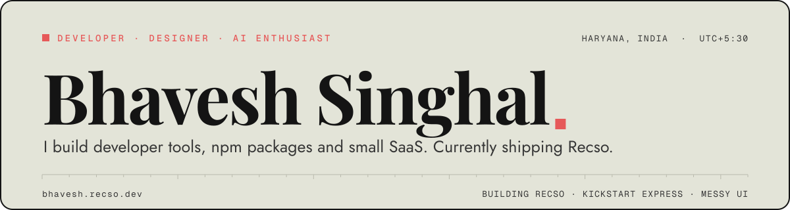

<div align="center">
  <picture>
    <source media="(prefers-color-scheme: dark)" srcset="https://raw.githubusercontent.com/bhaveshsinghal95182/bhaveshsinghal95182/main/assets/hero-dark.svg">
    
  </picture>
</div>

I'm Bhavesh, a CS student at MMDU Haryana. Most of what I write is TypeScript, Python and Rust. If a task annoys me twice, I write a tool so it doesn't get a third turn.

<div align="center">
  <a href="https://bhavesh.recso.dev"></a>
  <a href="https://bhavesh.recso.dev/resume"></a>
  <a href="https://x.com/descentkatil_"></a>
  <a href="mailto:worknbhavesh@gmail.com"></a>
  <a href="https://www.linkedin.com/in/bhavesh-singhal-2400a4328"></a>
</div>

```console
bhavesh@portfolio:~$ whoami
Bhavesh Singhal
  Backend, AI, and the small tools in between.

bhavesh@portfolio:~$ ls projects
recso              screen recorder and video editor for Windows
kickstart-express  Express scaffolder, then add db and auth to it
company-logos      shadcn-style CLI for company logo components
messy-ui           animated React components, shadcn registry
tweakcn-import     Figma plugin for tweakcn colour palettes

bhavesh@portfolio:~$ cat now.txt
Recso. Capture and encoding in Rust, editor in React.

bhavesh@portfolio:~$ open portfolio
opening bhavesh.recso.dev
```

That prompt is not a screenshot. The site has a working terminal. Press <kbd>~</kbd> on [bhavesh.recso.dev](https://bhavesh.recso.dev) and try `ls`, `cat recso`, `open resume`.

---

## Selected work

| project | stack |
| :------ | :---- |
| [**Recso**](https://recso.dev)<br>Screen recorder and video editor for Windows. The cursor is captured on its own layer, so you can restyle and smooth it after recording. | `TypeScript` `Rust` `React` |
| [**Kickstart Express**](https://github.com/bhaveshsinghal95182/kickstart-express)<br>Scaffolds an Express app in one command. `add db` and `add auth` keep it useful after minute one. | `TypeScript` `Node.js` `Inquirer` |
| [**Company Logos**](https://logos-www.vercel.app)<br>Copies company logo components straight into your project, the way shadcn does. TSX or JSX, your call. | `TypeScript` `Node.js` `React` |
| [**Messy UI**](https://messyui.dev)<br>Animated React components, installed through the shadcn registry. | `Next.js` `GSAP` `Motion` |
| [**tweakcn CSS Import**](https://www.figma.com/community/plugin/1533799530090421982/tweakcn-css-import)<br>A Figma plugin that reads a tweakcn theme's CSS variables and builds the palette for you. | `TypeScript` `Figma API` |

Two of them are packages you can install right now. Monthly downloads:

<a href="https://www.npmjs.com/package/kickstart-express"></a>
<a href="https://www.npmjs.com/package/company-logos"></a>

```bash
npx kickstart-express --name my-api --language ts --docker
npx company-logos add vercel next github --tsx
```

---

## Stack

```text
languages  TypeScript · JavaScript · Rust · Python · C++ · SQL
frontend   React · Next.js · Tailwind CSS · GSAP · Motion
backend    Node.js · Express · Django · FastAPI · Flask · Prisma
infra      Docker · Linux · Git · Appwrite · Postman · Vercel
```

Oracle Cloud Infrastructure 2025 Developer Professional, plus ServiceNow CAD and CSA. The long version is on the [resume](https://bhavesh.recso.dev/resume).

---

## Writing

[**Rebuilding this site**](https://bhavesh.recso.dev/writing/rebuilding-this-site). Replacing hardcoded numbers with live ones, and the small details that took longer than they should have. Three minutes.

---

## Activity

<div align="center">
  <picture>
    <source media="(prefers-color-scheme: dark)" srcset="https://raw.githubusercontent.com/bhaveshsinghal95182/bhaveshsinghal95182/output/snake-dark.svg">
    
  </picture>
</div>

The snake eats the contribution graph. It redraws every 12 hours.

---

<div align="center">
  <a href="https://www.youtube.com/@bhavesh_404">youtube</a> ·
  <a href="https://instagram.com/descentkatil_00005">instagram</a> ·
  <a href="https://buymeacoffee.com/descentkatil">buy me a coffee</a> ·
  <a href="mailto:worknbhavesh@gmail.com">worknbhavesh@gmail.com</a>
</div>

<div align="center">
  <picture>
    <source media="(prefers-color-scheme: dark)" srcset="https://raw.githubusercontent.com/bhaveshsinghal95182/bhaveshsinghal95182/main/assets/signature-dark.svg">
    
  </picture>
</div>
